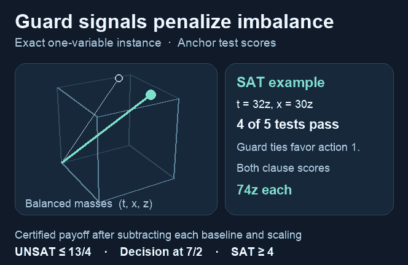

# The complexity of persuasion with a privately informed binary-action receiver

The payoff-threshold problem for offline Bayesian persuasion is **NP-complete** in the known-channel model with two receiver actions and sender-favorable ties. Hardness holds when the sender always earns 1 for action 1 and 0 for action 0. An inverse-polynomial payoff gap also rules out a deterministic additive FPTAS unless P = NP. [Source question](https://arxiv.org/html/2607.28342v1#Sx4.SSx5)

[Paper PDF](paper/manuscript.pdf) · [LaTeX source](paper/manuscript.tex) · [Catalog Q587](https://github.com/10m-u/open-problems-catalog/blob/ca8d4d44ba3db527f19f28928c240168f545ecfe/problems/game_theory/games-of-incomplete-information-bayesian-games.md#q587)

## Guard signals penalize imbalance

Every abstract variable has a plus and a minus state. The anchor rewards tests that pass. Balanced pairs pass their guards by the sender-favorable tie rule. In an arbitrary scheme, the guard loss from imbalance outweighs the additional anchor rewards it can introduce. In the worked pair, normalized certified payoffs are at least $4$ for the satisfiable formula and at most $13/4$ for the unsatisfiable formula, around threshold $7/2$.

[Download the offline explorer ZIP](https://raw.githubusercontent.com/DannyExperiments/binary-private-information-persuasion/v1.0.0/visualization/binary-private-information-persuasion-explorer.zip) · [Worked example and rendering guide](visualization/README.md)

## Scope and evidence

The receiver has two **actions**. The reduction has a growing finite private-signal alphabet, and any fixed alphabet size admits a polynomial-sized linear program. Earlier results concern larger action sets or receiver-specific utilities. [Literature audit](audits/public_safe_reports/LITERATURE_AUDIT.md) · [Exact scope](CLAIM_SCOPE_AND_LIMITATIONS.md)

[Exact replay](REPRODUCIBILITY.md) checks the private channel and finite rational examples. The [partial Lean certificate](formal/Q587Certificate.lean) verifies rational test, imbalance and gap inequalities. The full reduction and rational support result are proved in the manuscript. Internally reviewed, not peer reviewed. [Technical disclosure](AI_DISCLOSURE.md) · [Review status](STATUS.md)

DannyExperiments is the preferred citation identity. [Release v1.0.0](https://github.com/DannyExperiments/binary-private-information-persuasion/releases/tag/v1.0.0) · [Version DOI](https://doi.org/10.5281/zenodo.24572318) · [Citation metadata](CITATION.cff)
