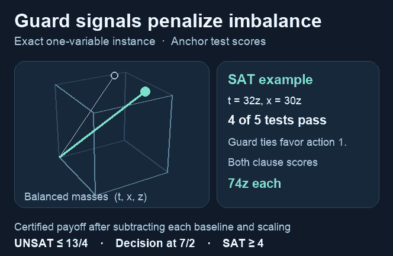

# Guard signals penalize imbalance

[Download the offline explorer ZIP](https://raw.githubusercontent.com/DannyExperiments/binary-private-information-persuasion/v1.0.0/visualization/binary-private-information-persuasion-explorer.zip). Unpack it and open the included HTML in a browser. Choose the second clause and the Boolean assignment, then rotate the mass-coordinate view.

The two example formulas are $(x\lor x\lor x)\land(x\lor x\lor x)$ and $(x\lor x\lor x)\land(\neg x\lor\neg x\lor\neg x)$. For both, $t=32z$ and $x$ is $30z$ or $2z$, with equal masses in each state pair. At $x=30z$, the former passes four tests and the latter three. The GIF shows certified bounds in units of one anchor reward above each instance's own baseline. The [manuscript](../paper/manuscript.pdf) gives the all-schemes proof.

The HTML works offline. To reproduce the GIF use an existing Python environment with Pillow and Arial or DejaVu Sans.

~~~sh
python3 visualization/render.py
~~~
